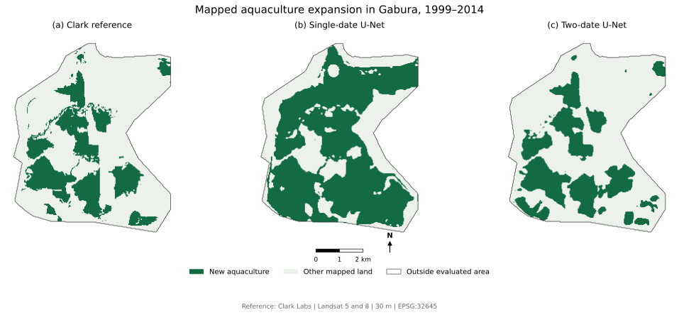
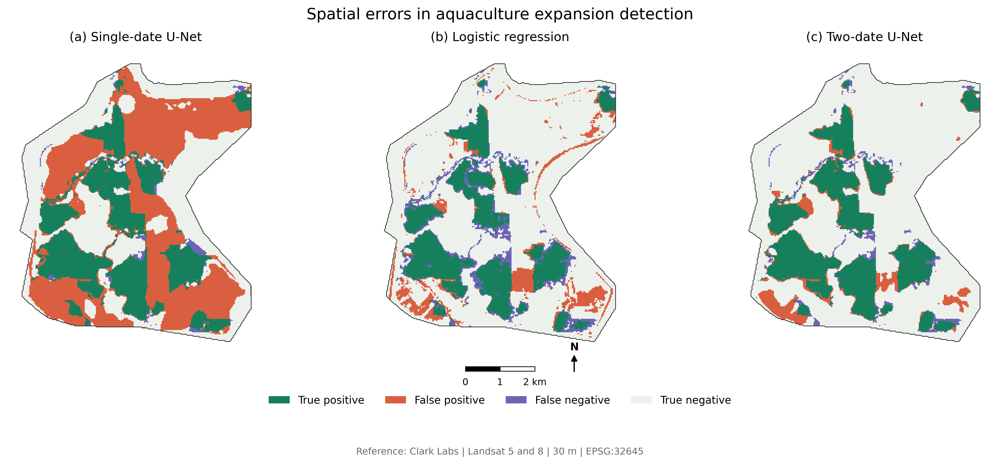
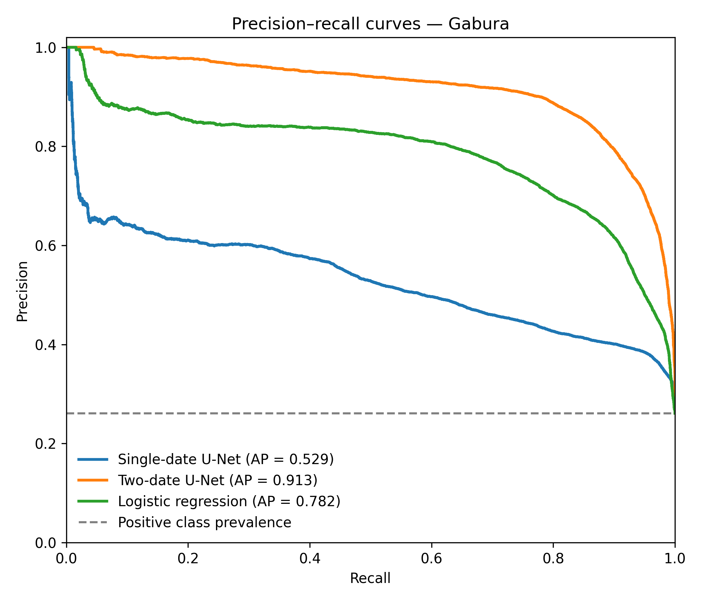

# Spatiotemporal GeoAI for Mapping Aquaculture Expansion in Coastal Bangladesh: A Case Study of Shyamnagar

I used Landsat imagery and machine learning to map aquaculture expansion in Shyamnagar Upazila, Bangladesh.

I first examined land-cover changes from 1999 to 2022 using the Clark Labs dataset. Then I compared three models for detecting newly mapped aquaculture between 1999 and 2014.

## Data

- Landsat 5 (1999) and Landsat 8 (2014)
- Clark Labs coastal aquaculture land-cover maps (1999, 2014, 2018, 2020, 2022)
- Shyamnagar upazila and union boundaries from geoBoundaries

I prepared the Landsat images in Google Earth Engine and used Python for the land-cover analysis. The U-Net models were trained in Google Colab using PyTorch.

## Methods

I compared three models:

- Single-date U-Net using 2014 Landsat imagery
- Two-date U-Net using 1999 and 2014 Landsat imagery
- Logistic regression using NDVI and MNDWI changes

I used separate unions for training, validation, and testing. Kashimari was used for validation and Gabura for testing.

## Results

The models were evaluated using the Clark Labs reference maps in Gabura.

| Model | Precision | Recall | F1 | IoU |
|---|---:|---:|---:|---:|
| Single-date U-Net | 0.388 | 0.942 | 0.550 | 0.379 |
| Logistic regression | 0.730 | 0.764 | 0.746 | 0.595 |
| Two-date U-Net | 0.810 | 0.888 | 0.847 | 0.735 |

The two-date U-Net performed better than the other models in this experiment.

### Aquaculture expansion maps

The maps compare the Clark Labs reference with the predictions from the two U-Net models in Gabura.

### Spatial error maps

The maps below show where each model correctly identified new aquaculture and where it made mistakes in Gabura.

### Precision–recall curves

The curves compare the three models across different classification thresholds.

## Limitations

The reference data are based on satellite classifications rather than field observations. Landsat 5 and Landsat 8 also have different sensor characteristics.

The models were tested in one upazila, and the geographic split was selected after examining the land-cover changes. Some patch-related patterns are visible in the probability maps.

The results describe mapped coastal aquaculture expansion, not confirmed shrimp farming.

## Data sources

- [Clark Labs aquaculture data](https://www.clarku.edu/geospatial-analytics/aquaculture-data-download/)
- [Google Earth Engine](https://earthengine.google.com/)
- [geoBoundaries](https://www.geoboundaries.org/)

The original satellite and land-cover datasets are not included in this repository.
